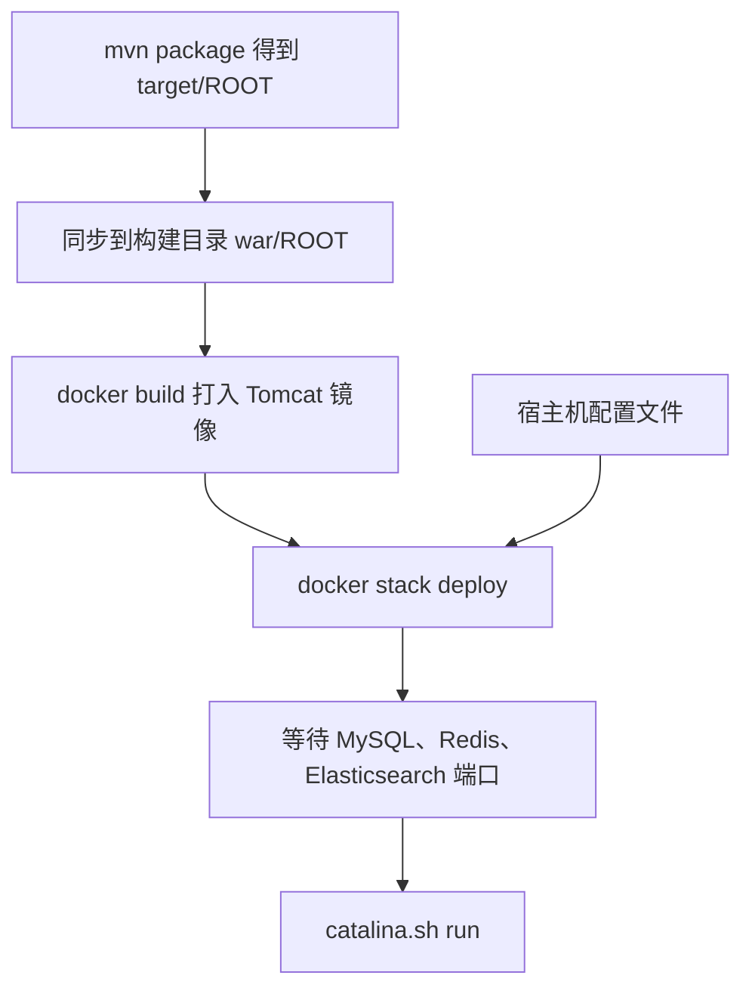

# 前言

把 Java Web 部署到服务器上，通常要先安装 JDK 和 Tomcat，并核对版本与路径。换一台机器就要重做，环境稍有差别，项目就启动失败。容器把 JDK 和 Tomcat 封进镜像：构建一次，在装有 Docker 的机器上用同一镜像启动，不再依赖宿主机是否已经装好 Java。

本文用 Ridgeyard 走完官方 Tomcat 镜像部署。测试时把 WAR 挂进容器；生产时编写 Dockerfile，放入解压后的 ROOT，再用 Docker Swarm 发布。按文中命令可以完成打包、构建、启动、访问和排错。

# 环境依赖与版本说明

本文命令在 **Ubuntu 22.04、linux/amd64** 上执行通过。Windows、macOS 安装 Docker Desktop 后，使用相同的 `docker` 命令；CentOS 7 已停止维护，不作为本次 Engine 版本的验证系统。

| 组件             | 版本                                                       |
| -------------- | -------------------------------------------------------- |
| 操作系统           | Ubuntu 22.04（验证环境）；Windows、macOS 使用 Docker Desktop       |
| Docker Engine  | 29.1.3，linux/amd64                                       |
| Docker Compose | v2.29.7                                                  |
| Tomcat 镜像      | `tomcat:9.0-jdk8-temurin-noble`，其中 Tomcat **9.0.122**    |
| 容器 JDK         | Eclipse Temurin JDK 8，基础镜像 `eclipse-temurin:8-jdk-noble` |
| 构建机 Java       | OpenJDK **1.8.0_504**                                    |
| 项目格式           | Maven 打出的 WAR；生产镜像使用解压后的 `target/ROOT`                   |
| 打包工具           | Maven                                                    |

| 项     | 说明                                                        |
| ----- | --------------------------------------------------------- |
| 应用上下文 | ROOT，后台入口 `/login.do`，容器端口 `8080`                         |
| 生产编排  | Docker Swarm，`endpoint_mode: dnsrr`，端口 `mode: host`，副本数 1 |
| 依赖    | MySQL、Redis、Elasticsearch，与应用在同一 overlay                  |

**环境示例：**

| 角色            | 示例地址                                     |
| ------------- | ---------------------------------------- |
| 镜像仓库          | `<registry>/<namespace>/ridgeyard:<tag>` |
| 任务节点          | `http://<任务节点IP>:8080/login.do`          |
| MySQL         | `<mysql-service>:3306`                   |
| Redis         | `<redis-service>:6379`                   |
| Elasticsearch | `http://<elasticsearch-service>:9200`    |
| 外部网络          | `<overlay-net>`                          |

# 核心原理简述

官方 Tomcat 镜像里已经带有 JDK 和 Tomcat 进程。容器启动后执行 `catalina.sh run`，**宿主机不必再安装 Java**。

标准 Java Web 的部署逻辑是：把 WAR 放到镜像内的 `/usr/local/tomcat/webapps/`。文件名决定上下文，`ROOT.war` 对应网站根路径 `/`，`app.war` 对应 `/app`。Tomcat 启动时会解压 WAR。

Ridgeyard 的生产镜像不走“启动后再解压”。Maven 先产出目录 `target/ROOT`，构建时拷进 `webapps/ROOT`。这样 jdbc、Redis 等配置可以按**单个文件**挂到 `WEB-INF/classes`，不会在解压时被盖掉，也不会把整个 `config` 目录盖住 Spring 的 XML。

两种用法：

| 方式    | 适用         | 做法                            |
| ----- | ---------- | ----------------------------- |
| 挂载部署  | 无外部配置的临时验证 | `docker run` 把 WAR 挂进官方镜像     |
| 自定义镜像 | 生产         | Dockerfile 打入应用，配置挂载，Swarm 发布 |

**端口映射**把容器 `8080` 接到宿主机端口。Swarm 使用 `mode: host` 时，这个端口只出现在**正在跑副本的那台节点**上。**数据挂载**把宿主机文件映进容器，改配置不用重新构建镜像。



## 拉取指定 Tomcat 镜像

使用带 JDK 8 的 9.0 标签，不要改用只写 `latest` 的标签，否则 JDK 大版本可能变化。

```bash
# 拉取 Tomcat 9.0.122 + Temurin JDK 8
docker pull tomcat:9.0-jdk8-temurin-noble
# 确认本地已有该标签
docker images tomcat:9.0-jdk8-temurin-noble
```

> 配图位置：`docker images` 中该标签的一行。

## 准备应用并打出 ROOT 目录

在仓库根目录打包。生产构建需要解压目录 `target/ROOT`，不能只有 `ROOT.war`。

```bash
cd <repo-root>
# 跳过测试，只打包
mvn -DskipTests package
# 把 target/ROOT 拷到 docker/Ridgeyard/war/ROOT
sh docker/copy.sh
```

| 参数               | 含义                      |
| ---------------- | ----------------------- |
| `-DskipTests`    | 不跑测试，缩短打包时间             |
| `docker/copy.sh` | 缺少 `target/ROOT` 时会直接退出 |

临时挂载实验若只有 WAR，把产物复制为 `ROOT.war` 即可，见下一章场景一。

## 规划目录

堆栈文件里的 `./Ridgeyard/...` 相对于执行 `docker stack deploy` 时的 `docker/` 目录。

```text
docker/
├── copy.sh
├── docker-swarm-ridgeyard.yml
└── Ridgeyard/
    ├── Dockerfile
    ├── docker-compose-wait/wait
    ├── war/ROOT
    ├── config/
    ├── conf/log4j.properties
    └── tomcat/conf/server.xml
```

| 宿主机（相对 `docker/`）                  | 容器内                                       |
| ---------------------------------- | ----------------------------------------- |
| `Ridgeyard/war/ROOT`               | `/usr/local/tomcat/webapps/ROOT`（构建时打进镜像） |
| `Ridgeyard/config` 下各个 properties  | `WEB-INF/classes/config/` 中的同名文件          |
| `Ridgeyard/conf/log4j.properties`  | `WEB-INF/classes/conf/log4j.properties`   |
| `Ridgeyard/tomcat/conf/server.xml` | `/usr/local/tomcat/conf/server.xml`       |

口令只写在宿主机 properties 中。jdbc、Redis、Elasticsearch 的主机使用 overlay 服务名和**容器端口**。当前环境没有消息队列时，`rabbitmq.enabled`、`amqp.enabled`、`rocketmq.enabled` 保持 `0`。

# 完整部署流程

### 编写 Dockerfile

在 `docker/Ridgeyard` 下构建。下面与当前镜像一致：补齐健康检查和 `ifconfig`，拷入已解压的 ROOT，启动前等待依赖端口。

```dockerfile
# Tomcat 9.0.122 + Temurin JDK 8 + Ubuntu Noble
FROM tomcat:9.0-jdk8-temurin-noble

ENV LANG=C.UTF-8 \
    LC_ALL=C.UTF-8 \
    TZ=UTC

# curl 供健康检查；net-tools 提供 ifconfig，许可校验会调用它
RUN set -eux; \
    apt-get update && apt-get install -y --no-install-recommends \
        curl procps net-tools iproute2 \
        fontconfig fonts-dejavu-core libfreetype6 tzdata; \
    apt-get clean; rm -rf /var/lib/apt/lists/* /var/cache/apt/*; \
    fc-cache -fv; \
    if [ ! -e /usr/bin/ifconfig ] && [ -x /usr/sbin/ifconfig ]; then \
        ln -sf /usr/sbin/ifconfig /usr/bin/ifconfig; \
    fi

# 启动前探测 MySQL、Redis、Elasticsearch，见下文 wait 的获取方式
COPY docker-compose-wait/wait /wait
RUN chmod +x /wait

WORKDIR /usr/local/tomcat
# 清掉镜像自带的示例应用
RUN rm -rf /usr/local/tomcat/webapps/*
# 放入已解压的根应用
COPY war/ROOT /usr/local/tomcat/webapps/ROOT

ENV JAVA_OPTS="-Xms512m -Xmx1024m -Djava.awt.headless=true -Djava.security.egd=file:/dev/./urandom -Dfile.encoding=UTF-8"

EXPOSE 8080
ENTRYPOINT ["/bin/sh", "-c"]
# 依赖端口就绪后，用 Tomcat 进程替换 shell
CMD ["/wait && exec catalina.sh run"]
```

| 指令              | 作用                                                 |
| --------------- | -------------------------------------------------- |
| `FROM`          | 锁定 Tomcat 9.0 与 JDK 8，避免 `latest` 漂移               |
| `RUN apt-get`   | 安装 `curl`、`ifconfig` 等，并删掉 apt 缓存以减小层体积            |
| `COPY war/ROOT` | 应用进入镜像；构建上下文必须是 `docker/Ridgeyard`                 |
| `EXPOSE 8080`   | 声明容器端口，真正发布由堆栈的 `ports` 完成                         |
| `CMD`           | `/wait` 读环境变量 `WAIT_HOSTS`，通过后执行 `catalina.sh run` |

`/wait` 来自开源工具 [docker-compose-wait](https://github.com/ufoscout/docker-compose-wait) **2.12.1**。它在应用启动前检查 `WAIT_HOSTS` 里的 `主机:端口` 是否可连接，超时由 `WAIT_TIMEOUT` 控制。镜像构建前，读者自行下载 Linux x86-64 的可执行文件，放到构建上下文中：

```bash
mkdir -p <repo-root>/docker/Ridgeyard/docker-compose-wait
# 发布页中的 wait 为 Linux x64 静态可执行文件
curl -fsSL -o <repo-root>/docker/Ridgeyard/docker-compose-wait/wait \
  https://github.com/ufoscout/docker-compose-wait/releases/download/2.12.1/wait
chmod +x <repo-root>/docker/Ridgeyard/docker-compose-wait/wait
```

其他架构在该仓库的 Releases 中选择对应文件名（如 `wait_aarch64`）。未设置 `WAIT_HOSTS` 时，该程序不会等待，直接执行后面的命令。

### 构建并推送

```bash
cd <repo-root>/docker/Ridgeyard
# 标签必须与堆栈里的 image 一致
docker build -t <registry>/<namespace>/ridgeyard:<tag> .
docker push <registry>/<namespace>/ridgeyard:<tag>
```

| 参数   | 含义                                           |
| ---- | -------------------------------------------- |
| `.`  | 当前目录为构建上下文，内含 `Dockerfile`、`war/ROOT`、`wait` |
| `-t` | 镜像名                                          |

### 用 Swarm 启动

先把下面的完整内容保存为 `docker/docker-swarm-ridgeyard.yml`。jdbc 等文件按**单个文件**挂载，不要挂整个 `config` 目录。镜像名换成自己的仓库地址。

```yaml
services:
  ridgeyard:
    image: <registry>/<namespace>/ridgeyard:<tag>
    ports:
      - target: 8080
        published: 8080
        protocol: tcp
        mode: host
    networks:
    - <overlay-net>
    healthcheck:
      test: ["CMD-SHELL", "curl -f http://localhost:8080 || exit 1"]
      interval: 30s
      timeout: 10s
      retries: 3
      start_period: 10s
    stop_grace_period: 30s
    volumes:
    - ./Ridgeyard/config/jdbc.properties:/usr/local/tomcat/webapps/ROOT/WEB-INF/classes/config/jdbc.properties
    - ./Ridgeyard/config/redis.properties:/usr/local/tomcat/webapps/ROOT/WEB-INF/classes/config/redis.properties
    - ./Ridgeyard/config/elasticsearch.properties:/usr/local/tomcat/webapps/ROOT/WEB-INF/classes/config/elasticsearch.properties
    - ./Ridgeyard/config/rabbitmq/rabbitmq.properties:/usr/local/tomcat/webapps/ROOT/WEB-INF/classes/config/rabbitmq/rabbitmq.properties
    - ./Ridgeyard/config/amqp/amqp.properties:/usr/local/tomcat/webapps/ROOT/WEB-INF/classes/config/amqp/amqp.properties
    - ./Ridgeyard/config/rocketmq/rocketmq.properties:/usr/local/tomcat/webapps/ROOT/WEB-INF/classes/config/rocketmq/rocketmq.properties
    - ./Ridgeyard/conf/log4j.properties:/usr/local/tomcat/webapps/ROOT/WEB-INF/classes/conf/log4j.properties
    - ./Ridgeyard/tomcat/conf/server.xml:/usr/local/tomcat/conf/server.xml
    environment:
      TZ: UTC
      WAIT_HOSTS: <mysql-service>:3306,<redis-service>:6379,<elasticsearch-service>:9200
      WAIT_TIMEOUT: 180
      JAVA_OPTS: "-Xms512m -Xmx1024m -Djava.awt.headless=true -Djava.security.egd=file:/dev/./urandom -Dfile.encoding=UTF-8"
    logging:
      driver: json-file
      options:
        max-size: "10m"
        max-file: "5"
    deploy:
      mode: replicated
      replicas: 1
      endpoint_mode: dnsrr
      restart_policy:
        condition: on-failure
        delay: 3s
        max_attempts: 3
        window: 90s
      rollback_config:
        parallelism: 1
        delay: 5s
        failure_action: pause
        monitor: 15s
        max_failure_ratio: 0
        order: stop-first
      update_config:
        parallelism: 1
        delay: 10s
        failure_action: pause
        monitor: 15s
        max_failure_ratio: 0
        order: stop-first
      placement:
        constraints:
        - node.labels.role==service
networks:
  <overlay-net>:
    external: true
```

然后给运行节点打标签，并确认 overlay 已存在。

```bash
docker swarm init
# 与堆栈 placement 中 node.labels.role==service 对应
docker node update --label-add role=service <节点名>
docker network create -d overlay --attachable <overlay-net>
# 必须在 docker/ 目录执行，否则 ./Ridgeyard 路径会错
cd <repo-root>/docker
docker stack deploy -c docker-swarm-ridgeyard.yml <stack-name>
```

| 参数              | 含义                             |
| --------------- | ------------------------------ |
| `role=service`  | 副本只会调度到带该标签的节点                 |
| `<overlay-net>` | 堆栈使用已存在的网络，不会自动创建              |
| `<stack-name>`  | 服务全名为 `<stack-name>_ridgeyard` |

堆栈中的关键设置：

| 项            | 取值                                                                       | 含义                          |
| ------------ | ------------------------------------------------------------------------ | --------------------------- |
| `WAIT_HOSTS` | `<mysql-service>:3306,<redis-service>:6379,<elasticsearch-service>:9200` | 最多等 180 秒                   |
| `JAVA_OPTS`  | `-Xms512m -Xmx1024m`，UTF-8                                               | 覆盖镜像里的同名变量                  |
| 健康检查         | `curl -f http://localhost:8080`                                          | 间隔 30 秒，`start_period` 10 秒 |
| 日志           | `json-file`，单文件 10m，保留 5 个                                               | 避免日志占满磁盘                    |
| 重启           | `on-failure`，最多 3 次                                                      | 进程异常退出后重拉                   |

只改了 properties 或 `server.xml` 时，不必重建镜像：

```bash
docker service update --force <stack-name>_ridgeyard
```

# 项目访问与功能测试

`mode: host` 且 `endpoint_mode: dnsrr` 时没有路由网格。先看任务落在哪台机器，再用那台机器的地址访问。

```bash
# NODE 列就是监听 8080 的主机
docker stack ps <stack-name> --no-trunc
docker service logs --tail 80 <stack-name>_ridgeyard
# 入口应返回 HTTP 200
curl -I http://<任务节点IP>:8080/login.do
```

| 访问位置   | 地址                                |
| ------ | --------------------------------- |
| 任务节点本机 | `http://127.0.0.1:8080/login.do`  |
| 局域网    | `http://<任务节点IP>:8080/login.do`   |
| 公网     | 安全组放行 `8080/tcp` 后，使用该节点公网地址的同一路径 |

打开登录页即表示容器、Tomcat 和 ROOT 上下文已经接通。再使用一套测试账号登录，确认能连上 MySQL。检索功能需要 Elasticsearch 账号可用，且 `elasticsearch.url` 指向 `http://<elasticsearch-service>:9200`。

防火墙示例：

```bash
# Ubuntu
sudo ufw allow 8080/tcp
# firewalld
sudo firewall-cmd --add-port=8080/tcp --permanent
sudo firewall-cmd --reload
```

云主机还要在安全组放行 `8080/tcp`。浏览器若提示不安全端口，把宿主机发布端口改回 `8080` 这类常规端口。

# 常见报错与问题排查

| 现象                          | 原因                                  | 处理                                                         |
| --------------------------- | ----------------------------------- | ---------------------------------------------------------- |
| 打开 `/` 是 404，或不是登录页         | 上下文不是根路径，或应访问 `/login.do`           | WAR 命名为 `ROOT.war`，或使用已解压的 `webapps/ROOT`；地址加上 `/login.do` |
| 管理节点的 `8080` 连不上，堆栈却显示已部署   | host 模式端口只在任务节点                     | `docker stack ps` 看 NODE，访问该节点 IP                          |
| 容器启动后马上退出，日志里找不到 `ifconfig` | 许可程序调用 `ifconfig`，基础镜像默认没有          | 使用带 `net-tools` 和 `/usr/bin/ifconfig` 链接的 Dockerfile 重新构建  |
| 日志停在等待依赖                    | `WAIT_HOSTS` 的服务名或端口不通，180 秒超时      | 在同一 overlay 上检查 3306、6379、9200                             |
| 进程起来但数据源报错                  | 整目录挂载盖住了 Spring XML，或 JDBC 仍指向容器外地址 | 改回按文件挂载；`jdbc.url` 使用 `<mysql-service>:3306`               |
| 健康检查一直 unhealthy            | `start_period` 只有 10 秒，Tomcat 尚未监听  | 加大 `start_period` 后 `docker service update`；确认镜像里有 `curl`  |
| 宿主机端口绑定失败                   | `8080` 已被占用                         | `ss -lntp                                                  |
| 挂载后应用读不到配置                  | 宿主机文件权限不足，或路径不是 `docker/` 下的相对路径    | 保证运行用户可读；在 `docker/` 目录执行 `stack deploy`                   |
| WAR 与 JDK 不匹配               | 项目是 JDK 8，镜像却是更高版本 JDK              | 固定 `tomcat:9.0-jdk8-temurin-noble`，构建机使用 1.8.0_504         |
| 页面能开，日志查询为空                 | 检索地址写成了宿主机映射端口，或索引字段类型与查询不一致        | `elasticsearch.url` 使用 overlay 上的 `9200`                   |

通用排查：

```bash
# 单容器
docker ps -a --filter name=ridgeyard
docker logs --tail 200 ridgeyard-test
# Swarm
docker service ps <stack-name>_ridgeyard --no-trunc
docker service logs --tail 200 <stack-name>_ridgeyard
```

# 总结与拓展

生产路径可以收成四步：`mvn -DskipTests package`，`sh docker/copy.sh`，在 `docker/Ridgeyard` 构建并推送镜像，在 `docker/` 执行 `docker stack deploy`。访问地址使用任务节点上的 `http://<任务节点IP>:8080/login.do`。配置变更用 `docker service update --force`，不要把口令写进 Dockerfile。

| 方面  | 传统安装 JDK 与 Tomcat | 本文的容器部署                       |
| --- | ----------------- | ----------------------------- |
| 环境  | 每台机器单独安装、单独对齐版本   | JDK 8 与 Tomcat 9.0.122 在镜像中固定 |
| 迁移  | 重装运行时并拷贝应用        | 拉取同一镜像，挂上配置后启动                |
| 配置  | 散落在服务器目录          | 宿主机文件挂载，与镜像分层                 |
| 发布  | 手工替换 WAR          | 构建镜像后由 Swarm 滚动任务             |

镜像推到私有仓库后，任务节点只需能拉取该标签。继续扩展时，可在构建流水线里执行打包和 `docker build`，发布阶段只更新服务镜像。当前副本保持 1，端口使用 host 模式，因此扩容前要先规划每台节点的端口和调度标签。

完成发布后，可持续观察 `docker stack ps <stack-name>` 是否保持 Running，以及 `docker service logs -f <stack-name>_ridgeyard` 里依赖等待和 Tomcat 启动是否连续成功。